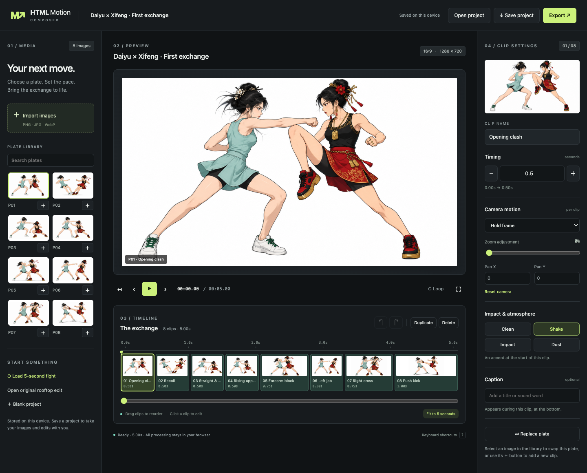

# HTML Motion Composer

A browser-based plate animation editor. Import images, arrange clips, adjust timing and camera motion, add captions and effects, then export a portable project, playable HTML, frame PNG, or video. No compose server or API key is required.



## Run locally

```sh
npm run dev
```

Open **http://127.0.0.1:8765/ui/**. Python 3 and Node.js are sufficient for local development; the editor itself has no npm runtime dependencies. Cloudflare Workers still serves `public/` through the existing `wrangler.jsonc`. This change does not deploy the live Worker.

The default project is **Daiyu × Xifeng · First exchange**: the eight original generated PNGs, in order, over exactly five seconds. Select **Open original rooftop edit** to open the existing 31.5-second / 63-plate project.

## Editing

- Click a timeline clip to edit its duration, camera, zoom, pan, effect, or caption. Preview updates automatically.
- Click a library image to replace the selected plate. Its **＋** button adds a new clip. Drag timeline clips to reorder them; Duplicate, Delete, Undo and Redo are available.
- Use Play/Pause, the scrubber, previous/next clip, restart, or loop. Space toggles playback. **Keyboard shortcuts** lists the other shortcuts.
- Import PNG/JPG/WebP images. Imported images and the current draft are stored in IndexedDB across reloads, subject to browser storage limits. Save a project before loading a demo or starting a blank project: those actions replace the active draft.
- **Save project** downloads `.motion.json` with embedded images, layouts and edits. **Open project** restores it on another device or origin. Old show-only JSON is supported when its layouts are shipped on the host.
- **Export → Playable HTML** produces one offline file with its images embedded. **Current frame** saves a PNG. **Record video** records the canvas in real time (WebM in Chrome; a supported MP4 recorder may be used by other browsers). Keep the tab visible during recording; interrupted recordings report an error.

## Five-second edit

| Plate | Action | Duration | Start |
|---|---|---:|---:|
| P01 | Opening clash | 0.50s | 0.00s |
| P02 | Recoil | 0.50s | 0.50s |
| P03 | Straight & duck | 0.50s | 1.00s |
| P04 | Rising uppercut | 0.50s | 1.50s |
| P05 | Forearm block | 0.75s | 2.00s |
| P06 | Left jab | 0.50s | 2.75s |
| P07 | Right cross | 0.75s | 3.25s |
| P08 | Push kick | 1.00s | 4.00s |

This is animation of existing plates with cuts, camera motion and effects. It does not synthesize new poses or interpolate limbs between the eight images. The originals are included without modifying their pixels.

## AI skill and ten-second continuation

The reusable skill lives in [`skills/html-motion-composer/SKILL.md`](skills/html-motion-composer/SKILL.md). It describes project authoring, new image generation, actual-alpha compositing, preservation of an existing edit, and verified offline/video exports. Its two helpers build a portable project and export through the actual editor in an isolated browser. They are parameterized by checkout, show/project, output paths, and fps.

The editor's **Open 10-second continuation** button opens the extended sample: the original eight clips and first five seconds are preserved, then eight newly generated transparent character PNGs play over a new dusk rooftop background. It is also available at `/ui/?show=daiyu-wang-ten-seconds` and `/player/?show=daiyu-wang-ten-seconds`.

```sh
node skills/html-motion-composer/scripts/build-project.cjs --repo . \
  --show public/shows/daiyu-wang-ten-seconds.json --out work/extended.motion.json \
  --base-show public/shows/daiyu-wang-five-seconds.json --append-seconds 5
node skills/html-motion-composer/scripts/export-project.cjs --repo . \
  --project work/extended.motion.json --html work/extended.html \
  --video work/extended.webm --report work/extended.verification.json --fps 30
```

These helpers require the dev dependencies and, for video, ffmpeg with VP8 support. `BROWSER_CHANNEL=chrome` uses installed Chrome; `FFMPEG` can select a binary. They do not publish projects or deploy the Worker.

## Verify

```sh
npm install
npx playwright install chromium
npm test
npm run dev                    # leave running in another terminal
npm run test:browser
```

Set `BROWSER_CHANNEL=chrome` to test an installed Chrome instead. Browser tests cover editing, transport, undo/redo, imports surviving reload, portable save/reopen, offline HTML, PNG/video downloads, the original project, and a 390px mobile layout. Local screenshots and downloads go under ignored `work/qa/`.

```sh
npm run build:demos
```

Rebuilds static `public/out/` players using the same browser compose engine. The five-second player is at `/player/?show=daiyu-wang-five-seconds`. It supports `&capture=1` and `window.renderAt(seconds)` for deterministic capture.

For a deterministic 150-frame / 30fps WebM export, install ffmpeg and run the development server, then:

```sh
node scripts/render-video.cjs five-seconds.webm
```

Set `FFMPEG` to a custom binary path if needed.

## Structure and scope

- `public/ui/`: product editor, persistence, shared canvas renderer, exports, and browser compose engine.
- `public/player/`: standalone player using the same renderer.
- `public/assets/daiyu-wang-eight/`: the eight supplied PNGs and their layout.
- `public/shows/` and `public/out/`: editable demos and compiled static player data.
- `src/worker.js`, `wrangler.jsonc`: existing static Cloudflare Workers host. Legacy API write stubs are not called by the editor.
- `kit/`: unchanged optional Python tools and older QA oracle. Library pose synthesis, template generation and server-side tools remain there; the product editor exposes the supported plate workflow.

Camera presets from the original kit are retained. Old PNG references to deployed WebP cutouts/JPG full plates are normalized when loading the legacy project. Existing original image assets and kit files are unchanged. Canvas preview and exports share one deterministic renderer; this is not a pixel-for-pixel copy of the old DOM player's blur and ghost effects.
