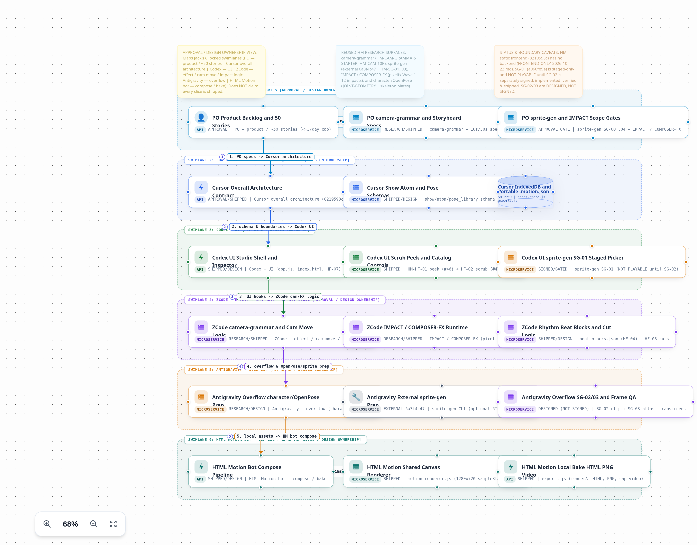
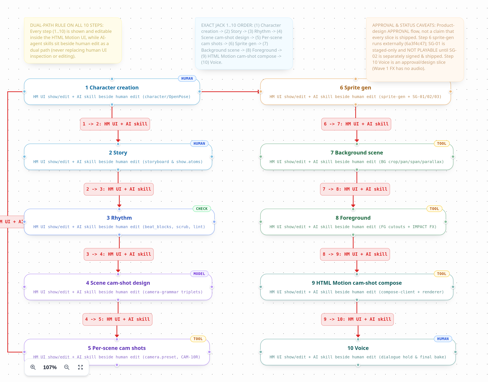

# HTML Motion product flow (APPROVED)

**Status:** APPROVED  
**Approver:** Jack Lee JP  
**Date:** 8 Nov 2026 (Asia/Tokyo)  
**Jack refs:** t2471u (revise: visual editable flow) · t2473u (go-ahead, and land these docs in the repo)  
**Approval Page:** https://cursor.com/canvas/store-4b196c92-d1a3-4894-af76-47a03d56f6ce/8cd93fd2-5ce0-4640-817c-8882fb7d0599

t2471u asked for a product flow Jack can see and edit. t2473u approved that design and asked for every diagram and design doc from the pack to live in this repository.

This folder is that landing. DiagramTool boards are the design source of truth. The HTML Motion frontend composer remains the place artifacts are shown and edited. Skills assist create/edit. n8n, when it is stood up later, is flow control and gates only.

The copied orchestrator brief and [`HANDOFF.json`](HANDOFF.json) still say research-and-recommendation and "IF Jack APPROVE". They were written before t2473u. This page records the approval that follows them. This landing does not install n8n, publish a skill, change the composer or schemas, or SIGN a story.

## Locked steps (1..10)

Every step is a process card on [`workflow.board.json`](workflow.board.json). The HTML Motion UI shows and edits the artifact. An AI skill sits beside that edit.

| # | Step | Dual path on the workflow board |
|---|---|---|
| 1 | Character creation | HM UI plate and character edit, with a character/OpenPose skill beside it |
| 2 | Story | HM UI atoms and the timeline JSON inspector, with a storyboard skill beside it |
| 3 | Rhythm | HM UI duration, frame peek, scrub, and beat blocks, with a rhythm and frame-QA skill beside it |
| 4 | Scene cam-shot design | HM UI camera-grammar templates and cut blocks, with a triplet-planner skill beside it |
| 5 | Per-scene cam shots | HM UI per-atom camera presets, with a preset-tuning skill beside it |
| 6 | Sprite gen | HM UI staged strip picker. External sprite-gen stays outside HTML Motion |
| 7 | Background scene | HM UI background plates (crop, pan, span, parallax), with a framing skill beside it |
| 8 | Foreground | HM UI cutouts and IMPACT / COMPOSER-FX, with a cutout and FX skill beside it |
| 9 | HTML Motion cam-shot compose | HM UI compose and the 1280×720 canvas, with `html-motion-composer` scripts beside it |
| 10 | Voice — HOLD / #41 | Dialogue-hold design step on the board. Wave 1 has no SFX or audio. Keep the node as a disabled HOLD until a later approval lifts it |

Order source: the workflow board sticky note "EXACT JACK 1..10 ORDER", plus [`workflow.dsl`](workflow.dsl).

Skill files for that order are indexed in [`HM-PF-51-skill-pack.md`](HM-PF-51-skill-pack.md) (HM-PF-51). A name that already has a skill stays as it is. A name with no file yet is a contract stub. Step 10 `hm-voice-track` is DESIGNED-HOLD only. This index does not SIGN voice or #41.

Sprite-gen (`6a3f4c47`) stays an external CLI. Step 6 handoff is [`HM-PF-25-spritegen-handoff.md`](HM-PF-25-spritegen-handoff.md): generation stays outside the FE, and Jack imports one strip PNG and one strip JSON through the File API. `HM-SG-01` is staged-only and **NOT PLAYABLE** until `HM-SG-02` is separately signed, implemented, verified, and shipped. `HM-SG-02`, `HM-SG-03`, and `HM-SG-04` are **DESIGNED (NOT SIGNED)** on the architecture board. Shipped claims inside the boards cite `fight-motion-kit` `main` at `8219598c2749daeeb3719840087964422ba46fa2`.

## Ownership lanes

Six swimlanes on [`architecture.board.json`](architecture.board.json). These are design-ownership bands.

| Lane | Board label | Owns |
|---|---|---|
| 1 | PO — product / ~50 stories | Backlog of about 50 stories, camera-grammar and storyboard specs, sprite-gen and IMPACT scope gates |
| 2 | Cursor overall architecture | Frontend-only contract, show / atom / pose schemas, IndexedDB and portable `.motion.json` |
| 3 | Codex — UI | Studio shell and inspector, scrub / peek / catalog, SG-01 staged picker |
| 4 | ZCode — effect / cam move / impact logic | Camera move logic, IMPACT / COMPOSER-FX runtime, rhythm beat blocks and cuts |
| 5 | Antigravity — overflow | character/OpenPose prep, external sprite-gen prep, SG-02/03 and frame QA |
| 6 | HTML Motion bot — compose / bake | Compose pipeline, shared canvas renderer, local HTML / PNG / video bake |

Research surfaces named on the architecture board: `camera-grammar`, `sprite-gen`, `IMPACT / COMPOSER-FX`, `character/OpenPose`.

## Flow control

The [camera cold-open guide](HM-PF-17-cold-open.md) documents the live
`fight-cam-grammar-starter` sample and its three I→A→R triplets plus Wide
re-establish. The frontend guide is served at `/product-flow.html`.
For step 3, [approved rhythm plans](RHYTHM-PACING.md) cover the single
`hm-rhythm-pacing` skill, human GO input, editable pack stamps, the impact meter,
and target-duration lint in the same portable project.
For steps 4–5, [scene camera authoring](CAMERA-AUTHORING.md) and the
[rooftop camera-grammar golden show](HM-PF-22-rooftop-golden-show.md) cover the
grammar field pointer in [HM-PF-24](HM-PF-24-cam-grammar-sync.md), plus the
template beat sheet, one-click Wide re-establish beat picker and zero-Wide lint,
strict preset maps, local text/JSON `Camera:` clause exports that round-trip into
skill inputs, human overrides, the existing chain engine with visible snap-zoom
controls, and FE-only bake.

| Role | Choice | Why it is in the approved pack |
|---|---|---|
| Primary | **n8n** (self-host Community first) | Visual canvas Jack can open and edit. Wait, Slack, and form gates between the 10 steps. HTTP nodes wrap skills and local scripts |
| Runner-up | **Dify** (self-host Community) | Strong in-canvas Human Input forms. Heavier stack, and those forms can start to compete with the HTML Motion UI |
| Fails the visual-edit bar | **LangGraph / LangSmith Studio** | Studio visualizes and debugs graphs written in code. It is not the Jack drag-edit canvas for this flow |
| Do not start here | **Flowise** | End of life 2026-08-31 |

[`HANDOFF.json`](HANDOFF.json) records the same pick: `"pick": "n8n"`, `"runner_up": "Dify"`, `"jack_can_visual_edit": true`. Cursor catalog plugin id `73065872` is listed there and is not installed.

The one-page control contract is [`DUAL-PATH-CONTRACT.md`](DUAL-PATH-CONTRACT.md). Standing up n8n is still a spike. HM-PF-49 left the spike plan, a Docker compose file, workflow JSON, and gate notes outside this kit. Docker runtime smoke is Jack-side and does not block the contract. This landing still does not install n8n or plugin `73065872`.

## Separation

Owns and must-not-own for n8n, the HTML Motion UI, skills, and the DiagramTool boards are in [`DUAL-PATH-CONTRACT.md`](DUAL-PATH-CONTRACT.md).

n8n sequences the dual path and pauses for Jack. Plate, camera, and compose stay in the frontend composer. `.motion.json` stays the artifact. Skills do not replace the human edit and do not add a product compose backend.

## Constraints that stay in force

- **FE-only.** Workers UI, IndexedDB, localStorage draft, and `.motion.json`. See [`docs/FRONTEND-ONLY-2026-10-23.md`](../FRONTEND-ONLY-2026-10-23.md) and [`MOTION-JSON-SOT.md`](MOTION-JSON-SOT.md) (HM-PF-44).
- **Forge.** Composer and show land on this repo. Wave 1 FX vendor authorship lands on pixelfx (`patch-gg/pixelfx` is App pull-only; the writable build fork is `leejpjack-hue/pixelfx`). Checklist: [`FORGE-BOUNDARY.md`](FORGE-BOUNDARY.md) (HM-PF-52).
- **Cap.** At most 3 SIGNED HTML Motion stories per weekday.
- **Voice / #41.** HOLD. This approval does not SIGN SFX or audio.
- **Jack bar.** Open a fight, tweak, and compose within 60 seconds. The 5.00s eight-plate demo (`daiyu-wang-five-seconds`) stays intact.

## Files in this folder

| Path | Role |
|---|---|
| [`DUAL-PATH-CONTRACT.md`](DUAL-PATH-CONTRACT.md) | n8n, HTML Motion UI, and skills Owns / Must-not-own contract (HM-PF-50) |
| [`MOTION-JSON-SOT.md`](MOTION-JSON-SOT.md) | Any-step edit loop: one `.motion.json`, localStorage draft plus file reopen (HM-PF-44) |
| [`FORGE-BOUNDARY.md`](FORGE-BOUNDARY.md) | FE-only forge checklist: composer/show on this kit, Wave 1 FX vendor on pixelfx (HM-PF-52) |
| [`HM-PF-24-cam-grammar-sync.md`](HM-PF-24-cam-grammar-sync.md) | Notion ↔ box camera-grammar pointer, locked labels, and drift checklist (HM-PF-24) |
| [`HM-PF-51-skill-pack.md`](HM-PF-51-skill-pack.md) | Approval skill name set: shipped skills left in place, contract stubs for the missing names, voice DESIGNED-HOLD (HM-PF-51) |
| [`beat-id-bridge.md`](beat-id-bridge.md) | Storyboard `beat_id` shared with `.motion.json` atoms (HM-PF-08). n8n sees the same ids |
| [`architecture.board.json`](architecture.board.json) | DiagramTool v3.0 architecture board (design SoT) |
| [`architecture.dsl`](architecture.dsl) | Native DSL for that board |
| [`architecture.product.png`](architecture.product.png) | Product PNG export of the architecture board |
| [`architecture.canvas.png`](architecture.canvas.png) | Canvas PNG of the same architecture board |
| [`workflow.board.json`](workflow.board.json) | DiagramTool v3.0 flow board, steps 1..10 (design SoT) |
| [`workflow.dsl`](workflow.dsl) | Native DSL for that board |
| [`workflow.product.png`](workflow.product.png) | Product PNG export of the workflow board |
| [`workflow.canvas.png`](workflow.canvas.png) | Canvas PNG of the same workflow board |
| [`companion-notes.md`](companion-notes.md) | Board companion notes (2026-11-08) |
| [`evidence.md`](evidence.md) | Local parser and MCP validation evidence |
| [`validation-receipt.json`](validation-receipt.json) | Structural counts and SHA-256 of the board sources |
| [`hm-flow-orchestrator-choice-2026-11-08.md`](hm-flow-orchestrator-choice-2026-11-08.md) | Orchestrator comparison; n8n primary, Dify runner-up |
| [`HANDOFF.json`](HANDOFF.json) | Machine-readable pick, risks, and next steps |

[`validation-receipt.json`](validation-receipt.json) is a local DiagramTool parser receipt (Node v22.20.0 against diagram-tool `3dd1658e`), not a live browser export. Both boards passed `validatePortableDocument` with `layoutDeltaPx` 0 and no watermark. Digests recorded there, and matched by the copies in this folder:

| File | SHA-256 |
|---|---|
| `architecture.dsl` | `73da7377056d489a9e2c42152f861ab88efc38278f99959cc99910d4bde5d6ad` |
| `architecture.board.json` | `daa8dad6cec71bb299f7895470c40cd3c9ff581959de01d0ba393d798e8de246` |
| `workflow.dsl` | `c7c86c04089e50477ac056876d358c22e81e513be51540e3761013a5627640dc` |
| `workflow.board.json` | `a3a09a792207dac392bb240f9873ffd111568badad7478841cea41b2c3552e37` |
| `companion-notes.md` | `8f7fe91971cf971eb45f96bb4e158bdf3f59676eac46946f7a153063ed9369cb` |
| `evidence.md` | `e4d0c635661cef2ebed43180112300f4bc516429dfc16989bed4d0db97d72c2a` |

Companion notes, evidence, and the orchestrator brief keep their original `/workspace/...` paths. Those paths are the evidence trail from 2026-11-08. The table above is where the same files live in this repo.

## Diagrams

### Architecture — six ownership lanes

Canvas capture of the same board: [`architecture.canvas.png`](architecture.canvas.png).

### Workflow — steps 1..10

Canvas capture of the same board: [`workflow.canvas.png`](workflow.canvas.png).
